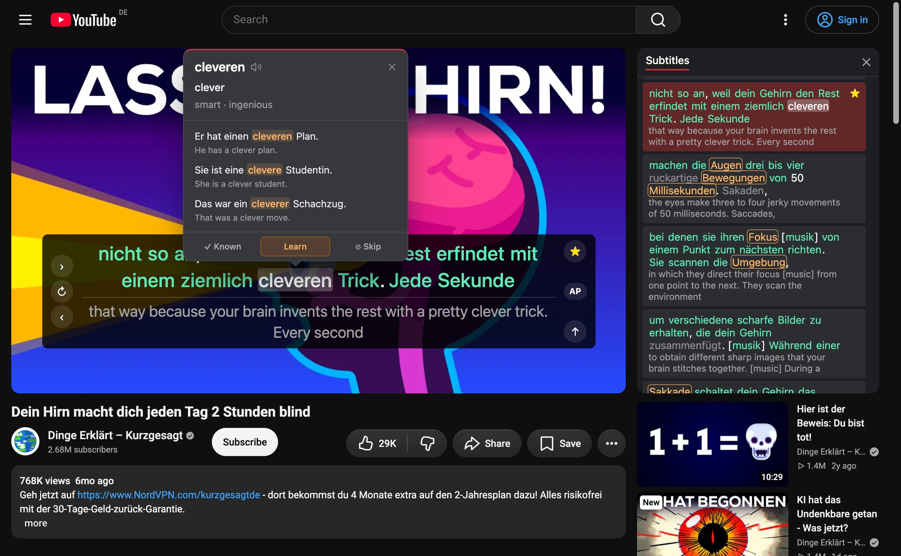

<h1>
  <picture>
    <source media="(prefers-color-scheme: dark)" srcset="docs/logo-dark.svg" />
    
  </picture>
</h1>

A Chrome extension (Manifest V3) to learn languages with YouTube.
It is inspired by Language Reactor. LingoMingo is not affiliated with Language Reactor, YouTube or Google.



## Install

1. Download the zip file (`lingomingo-***.zip`) from the [latest release](https://github.com/mort3za/lingomingo/releases/latest).
2. Unzip it into a folder that you keep (Chrome loads the extension from this folder).
3. Open `chrome://extensions` and turn on **Developer mode** (top right).
4. Click **Load unpacked** and select the unzipped folder.
5. Click the LingoMingo toolbar icon to open the app. In **Settings**, set your study language and your native language.
6. Open a YouTube video with subtitles.

You need **your own API key** to enable subtitle translation and the word dictionary. Get a key from [Claude](https://console.anthropic.com/), [OpenAI (ChatGPT)](https://platform.openai.com/api-keys), [xAI (Grok)](https://console.x.ai/), [DeepSeek](https://platform.deepseek.com/), [Google Gemini](https://aistudio.google.com/api-keys) (free tier) or [OpenRouter](https://openrouter.ai/keys) (free models), and add it in **Settings**. Or use a local model (Ollama, llama.cpp server, LM Studio) without a key.

To update: download the new zip, replace the files in the same folder, then click the reload icon of LingoMingo on `chrome://extensions`.

## Development

```bash
bun install
bun run dev
```

`bun run dev` writes a dev build to `dist/` and reloads on change. Keep it running. To load it in Chrome: open `chrome://extensions`, turn on **Developer mode**, click **Load unpacked** and select the `dist/` folder.

To make a release, run `bun run release patch|minor|major` on `main`. It bumps the version, tags and pushes. GitHub Actions then builds the zip and makes the release.

### Scripts

| Command                | What it does                                    |
| ---------------------- | ----------------------------------------------- |
| `bun run dev`          | Dev build in `dist/` with HMR (keep it running) |
| `bun run build`        | Production build in `dist/`                     |
| `bun run typecheck`    | Type check with `vue-tsc`                       |
| `bun run lint`         | ESLint                                          |
| `bun run format`       | Prettier (write)                                |
| `bun run format:check` | Prettier (check only)                           |
| `bun run test`         | `bun test`                                      |

## Privacy

LingoMingo has no server, no analytics and no cookies. See [PRIVACY.md](PRIVACY.md).

## License

Code: [GNU GPL v3](LICENSE) or later. Open source libraries in the extension: [public/THIRD_PARTY_LICENSES.txt](public/THIRD_PARTY_LICENSES.txt).

Word lists in `public/freq/` have their own licenses: frequency lists (`<lang>.txt`) are CC BY-SA 4.0, lemma lists (`<lang>-lemmas.txt`) are ODbL 1.0. See [public/freq/CREDITS.txt](public/freq/CREDITS.txt). To make them again: `bun scripts/freq-lists.ts`.
