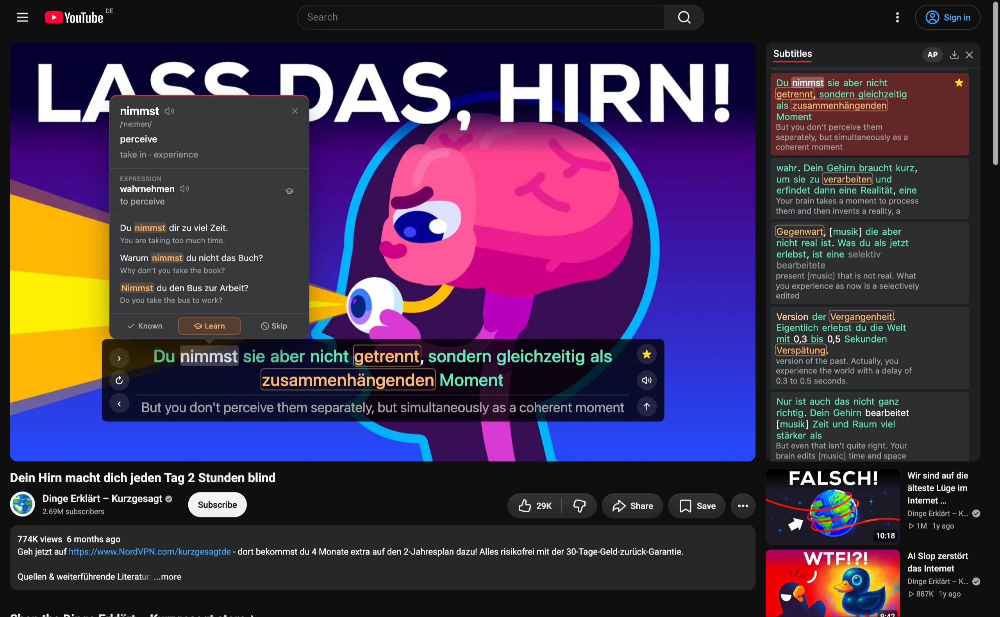

LingoMingo is a free, open source Chrome extension to learn languages with YouTube. Watch with two subtitles at once, click a word to see its meaning, save it, and review it later.

- [Install from the Chrome Web Store](https://chromewebstore.google.com/detail/lingomingo/ecodbdmdfdpodfiifnacmnahkdaijkln)
- [Privacy policy](privacy.html)
- [Source code on GitHub](https://github.com/mort3za/lingomingo) (GPL-3.0)

## Google Drive sync

LingoMingo can sync your saved words, review progress and settings between your browsers. It keeps one file in the hidden app data folder of your own Google Drive, and it cannot see your other files. The sync is off until you click "Connect Google Drive" in Settings. See the [privacy policy](privacy.html) for the details.

LingoMingo is not affiliated with YouTube or Google.
